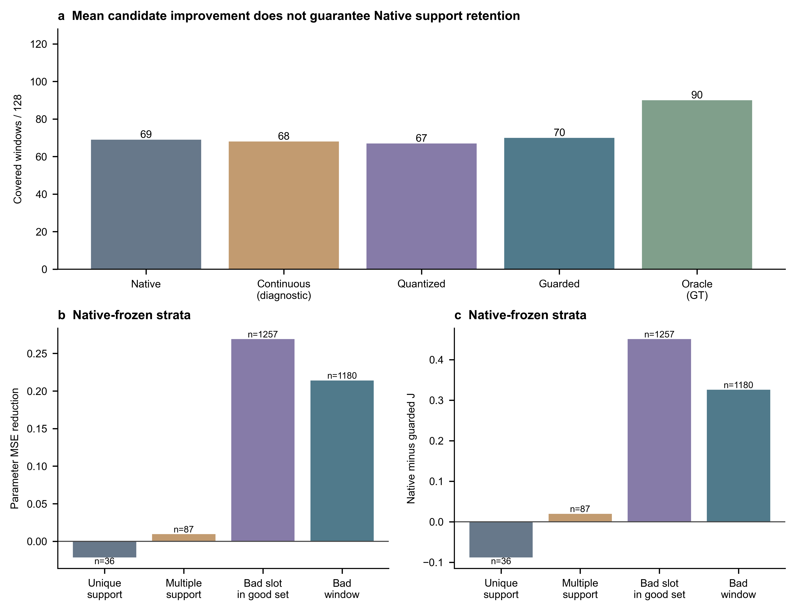

# 端点修正失败归因：关键支持保护应优先于继续压低平均候选误差

状态：**PASS_OFFLINE_ATTRIBUTION**；首选建议：**PRIORITIZE_SET_UTILITY**。仅给出下一轮单因素设计方向，不自动训练。

## 1. 结论与证据范围

已完成A0/A1/A2/A3：原128训练窗、97条sequence-target tracks、全部2560候选；640个五端口窗口、5120个固定K20单槽反事实、全部近邻/哈希参照和5000整track探索抽样。0训练、0前向、没有读取模型/pickle。原tiny未过90%的STOP、TIME停止、P3未触发及正式G/H未测均不变。

最清楚的结果不是“没有学会”：平均参数误差和许多失败槽J确实改善；但7个最终丢失窗都依赖唯一Native-good槽，并且在连续预测C时已坏。五端口轨迹与指标见[候选逐阶段表](candidate_stage_audit.csv)、[阶段窗口表](window_stage_transitions.csv)。

## 2. 连续→量化→过滤：不是过滤首先毁掉这7例

|端口|好窗/128|救回|丢失|平均minADE|平均minFDE|平均minJ|
|---|---:|---:|---:|---:|---:|---:|
|N|69|0|0|0.172394|0.304170|0.985209|
|C|68|8|9|0.181899|0.322637|1.027250|
|Q|67|8|10|0.182583|0.323436|1.033502|
|S|70|8|7|0.181195|0.318399|1.020114|
|O|90|21|0|0.138850|0.221616|0.762302|

N→C救8丢9；C→Q救2丢3；Q→S救3丢0。阶段码完整保留逆转，不能将7个丢失强塞成互斥原因箱。最终7例均为1→0→0→0，5例关键槽的教师就是identity（不修正），另2例为active教师但预测不对。7例来自5条track，其中同一条track贡献3例；不是7个独立行人样本。

C有77/2560候选超出.4m圆形动作域；C的470个候选违反至少一个guard位、Q为398个，S/O为0。全人口四组五pooled motion与junction通过，不等于C每条轨迹合法。C仅中间表示诊断，不能据此取消量化或安全标准。O为GT safe oracle，90好窗/21救回/0丢失是可达机会，不是可学或部署证据。

## 3. 平均收益落在哪里

|Native固定层|候选/窗口|ΔMSE均值|ΔJ均值|ΔMSE有符号贡献|ΔJ有符号贡献|
|---|---:|---:|---:|---:|---:|
|unique_support|36/36|-0.021623|-0.088190|-0.13%|-0.33%|
|multiple_support|87/33|0.009521|0.019667|0.14%|0.18%|
|failed_slot_in_success_window|1257/69|0.269036|0.450499|57.24%|59.67%|
|original_failure_window|1180/59|0.214013|0.325573|42.75%|40.48%|

ΔMSE=初始误差−末误差，ΔJ=Native−S，正数更好。总和可以出现负贡献或单层贡献超过100%；未取绝对值或裁负。所有分组/active与identity交叉及候选加权、窗内平均后窗口加权版本均在[gain_allocation.csv](gain_allocation.csv)。

36个唯一支持槽总体ΔJ=-0.08819，8槽变坏，其中一窗被其他槽补救，因此最终丢7窗。唯一支持identity的19槽平均ΔMSE=-0.09128、ΔJ=-0.20576，6槽最终变坏；这与“把原本应当不动的关键槽移坏”相符，但不证明换某个loss必然解决。多支持87槽/33窗表现较稳，不能把所有原好槽一概说受损。

原失败59窗的1180槽平均J改善0.32557，但仅8窗真正跨过完整coverage边界。S精确教师动作命中30.27%，safe J在oracle+.01内32.19%；参数误差、动作命中和完整集合覆盖是不同指标，不能替代。

## 4. 两类单槽反事实

全部128×20的restore与edit均为K20，固定其余19条，完整重算quality、原complete-link聚簇、五motion及junction。restore相对S恰有7个集合救回7个lost窗，同时8个集合会撤掉S新获得的覆盖。Native背景仅单槽修正有9个救回集合和8个丢失集合；计数单位为集合，不能与独立窗口或可加贡献混淆。

**恢复原成功槽必然救回是定义性结果**，不能部署GT选槽；也未搜索2^20组合或声称Shapley/训练因果。完整表：[restore](single_slot_restore_v2.csv)、[edit](single_slot_edit_v2.csv)。

## 5. 输入近邻：有局部相容性，尚无精确输入硬冲突证据

G/H近邻及哈希参照先于本轮GT/教师关联封存。全部同track候选排除，每reference track至多1条；主口径同sequence，另给跨sequence敏感性。60候选（3窗）只有2条同sequence参考track，保留真实数量，未跨sequence补齐。

同sequence H最近1条：平均教师参数距离0.4063、动作相同38.36%、提议安全82.81%、执行J-gap0.22456；最近5条均值分别为0.4977、30.86%、75.59%、0.26676。哈希参照top5执行J-gap0.48436；近邻相对参照约-0.21760。两组实际距离分布均报告，哈希不保证逐查询更远，也不构成随机化因果对照。

不把不同标签直接称功能冲突：[交叉效用表](neighbor_functional_equivalence.csv)同时列出不同标签但执行近oracle、且提议自身安全的数量，避免把fallback identity混成原提议可用。G/H各2560个float32输入均无精确重复，经验重复输入MSE下界均为0；仅表示未找到这类硬冲突，不能证明信息充分，更不是Bayes误差为0。

## 6. 全事件图与统计

[全部15事件索引](CASE_INDEX.md)和[合并案例PDF](cases/ALL_15_CASES.pdf)包含全部7 lost+8 rescue：past、GT、所有20槽、所有Native-good支持、C/Q/S/O和7位guard原因。原生物理slot不等于语义意图。

六个预定描述量共用5000整track重抽样，均5000有效；不做新p值/确认性检验。S−N覆盖差0.78125pp，探索95%区间约[-6.67,+7.69]pp；原好丢失率10.14%，区间约[1.64,20.34]%；不能凭净增1称可靠提升。详见[DESCRIPTIVE_CI.json](DESCRIPTIVE_CI.json)。

## 7. 下一方向为什么选集合效用，而不先怪安全门

优先建议固定结构/解码，在下一份精确协议中单因素检验集合效用/成功保留监督。理由是稀少的唯一支持槽受损，而普通失败槽的大量收益支配平均目标；这只是比继续同时扩大网络/预算更有针对性的证据排序。

竞争解释仍保留：固定映射拟合未达90%；量化确实新增3个暂时损失也救回2个；邻近输入仍可能缺少条件。安全门并非当前7例最早损伤点，且Q→S净救3无新增丢失，不支持放宽1.01。没有精确重复冲突，不代表未来完全可观测；近邻相关性不等于H对G增量。

## 8. 完成性、反方审核与限制

来源继承5140旧digest和全部父最终输出；新来源初末SHA一致，全部新增输出封存后逐文件读回。checkpoint仅文件SHA。独立第二实现复核640端口、5120反事实的质量/完整聚簇/运动、全部近邻排除/tie/hash、精确冲突下界及5000×6抽样算术；补核全部20组pooled/junction和48收益单元。这里“独立”指同助手第二套算术实现，不是外部审稿或模型/梯度再次回放。

DA1：看到7lost后的探索，完整128/全部事件约束选择偏差。DA2：GT恢复和oracle的定义性优势不是创新，单槽反事实不代表可学策略。DA3：平均收益错位并不证实任何新loss必胜，C越界、距离混杂、样本稀少、同track相关与已参与拟合均明确保留。

仅既有去标识数据、无新数据参与者；AI辅助分析和同助手反方审核如实披露。旧模型/结果/失败/日志/枚举/自动记录未删，旧PAUSED未动，baseline/historycycle11/长期目标不变。本有限离线诊断结束，不自动新增训练。

## 9. 本轮实现修复与保留来源

补充审核曾因junction观察差分精度不一致失败：五端口原实现正确先float64，而新增反事实与其首版第二实现先float32差分。保留全部v1脚本、表格、原review PASS及FAILURE_REVIEW_JUNCTION_PRECISION_V1.json，不把v1审核误称覆盖正确精度。v2只重算5120集合的junction mean/p95，最大改变量1.86253e-7；路径、覆盖、quality、聚簇和其余五motion字段逐数组bitwise不变。完整第二实现从头复核v2，20组补充审核也用原float64顺序，容差仍2e-12、literal门无epsilon；以counterfactual_metrics_v2.npz、两个_v2.csv及completion_review_v2为当前结果。近邻不足5条的NaN填充均值与收据字段名亦有显式review adapter，旧源码保留，未改原科学。
